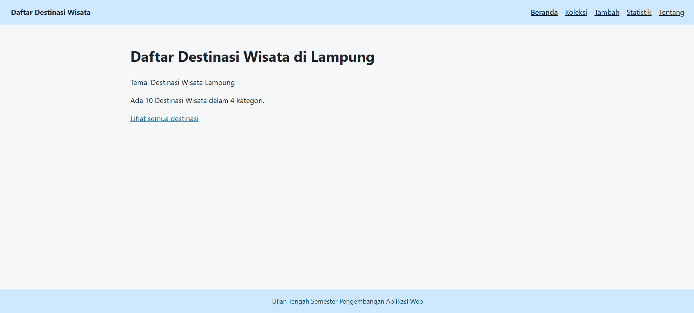
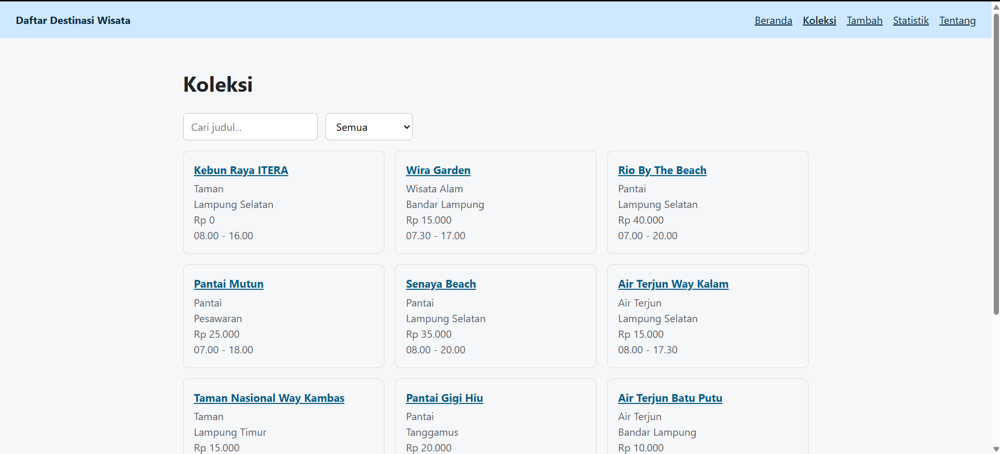
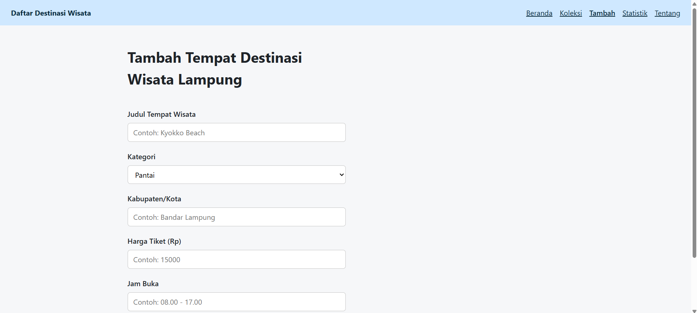
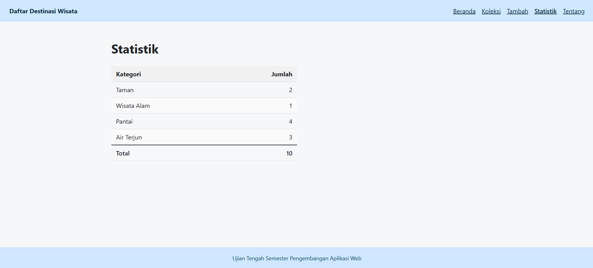
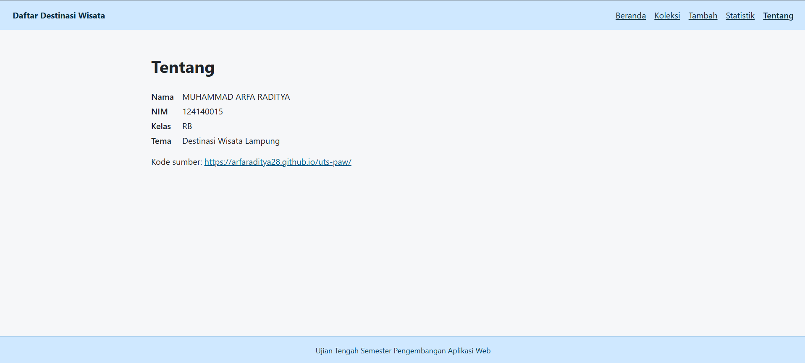
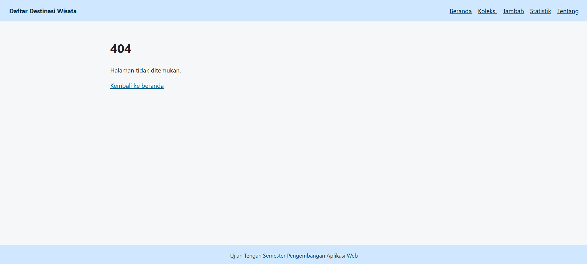

# Nama Aplikasi

Nama: MUHAMMAD ARFA RADITYA
NIM: 124140015
Kelas: RB
Tema: Destinasi Wisata Lampung
Deployment: https://arfaraditya28.github.io/uts-paw/

## Screenshot

1. **Tampilan Page Beranda**



2. **Tampilan Page Koleksi**



3. **Tampilan Page Tambah**



4. **Tampilan Page Statistik**



5. **Tampilan Page Tentang**



6. **Tampilan Page Error 404**



## Fitur

1. **Beranda** — menampilkan judul aplikasi, tema, serta ringkasan jumlah destinasi dan jumlah kategori.
2. **Koleksi** — menampilkan seluruh destinasi dalam bentuk kartu (kategori, kabupaten/kota, harga tiket, jam buka), dilengkapi pencarian berdasarkan judul dan filter per kategori.
3. **Tambah** — menambahkan tempat destinasi wisata dengan memasukkan judul, kategori, kabupaten/kota, harga tiket, dan jam buka
4. **Statistik** — tabel jumlah destinasi per kategori beserta total keseluruhan.
5. **Tentang** — menampilkan biodata (nama, NIM, kelas, tema) yang dibaca dari `mahasiswa.json` serta tautan ke repositori.

## Menjalankan secara lokal

```bash
cd app
npm install
npm run dev
